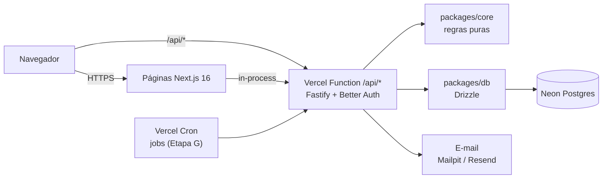

# AprovaAI

<!-- Troque SEU-USUARIO pelo dono do repositório no GitHub depois do primeiro push. -->

[](https://github.com/SEU-USUARIO/aprovaai/actions/workflows/ci.yml)

Plataforma de preparação para concursos públicos que responde, todos os dias: **"o que eu devo estudar agora, e por quê?"**

## Contexto

Quem estuda para concurso no Brasil lida com editais extensos, bancas com estilos diferentes (Cebraspe, FGV, FCC, Vunesp...)
e pouco tempo. Planilhas e cronogramas rígidos quebram na primeira semana atrasada.

## Problema

- O candidato não sabe priorizar: estuda o que gosta, não o que pesa no edital nem o que mais erra.
- Cronogramas fixos acumulam "dívida" quando se perde um dia.
- Erros em questões não voltam para revisão no momento certo.

## Solução

Um **ciclo de estudos dinâmico** por concurso-alvo:

- O edital verticalizado é a fonte da verdade (disciplinas, assuntos, pesos).
- A prioridade de cada assunto combina importância no edital, dificuldade observada, necessidade de revisão,
  incidência na banca e cobertura pendente. Toda tarefa vem com **justificativa** legível.
- Erros classificados (falta de teoria, pegadinha, atenção...) mudam o tipo do próximo bloco e entram em
  **revisão espaçada** (1/7/30 dias).
- Sem promessa de aprovação: o foco é organização, constância e atacar o que mais derruba a nota.

Detalhes completos em [docs/architecture.md](docs/architecture.md).

## Arquitetura



- **Tudo num único projeto Vercel:** a API Fastify é uma biblioteca executada pela rota `app/api/[...path]` do Next.
  Um domínio só, cookie de sessão first-party (`httpOnly`, `SameSite=Lax`) e um único deploy.
- Autorização sempre no backend (RBAC `user | editor | admin`) e isolamento por dono testado.
- Decisões registradas em [docs/decisions.md](docs/decisions.md) e segurança em [docs/security.md](docs/security.md).

## Stack

| Camada | Tecnologia                                                                                          |
| ------ | --------------------------------------------------------------------------------------------------- |
| Web    | Next.js 16 (App Router), React 19, TypeScript, Tailwind 4, TanStack Query, React Hook Form + Zod    |
| API    | Node.js 24, Fastify 5, Zod 4, OpenAPI/Swagger                                                       |
| Auth   | Better Auth (Argon2id, verificação de e-mail, reset, sessões revogáveis, rate limit)                |
| Dados  | PostgreSQL 17, Drizzle ORM                                                                          |
| Testes | Vitest (unitário + integração com Postgres), Playwright (E2E)                                       |
| Infra  | Vercel (functions gru1), Neon, Resend, pnpm + Turborepo, Docker Compose (dev), GitHub Actions, pino |

## Como rodar (Windows / PowerShell)

Pré-requisitos: Node 24, pnpm 9 (`corepack enable`), Docker Desktop.

```powershell
git clone <url-do-repo> aprovaai ; cd aprovaai
Copy-Item .env.example .env
# Gere um segredo e cole em BETTER_AUTH_SECRET no .env:
node -e "console.log(require('crypto').randomBytes(32).toString('base64url'))"

docker compose up -d        # Postgres + Mailpit
pnpm install
pnpm db:migrate
pnpm db:seed
pnpm dev                    # http://localhost:3000 (Swagger da API em /api/docs)
```

- E-mails de desenvolvimento (verificação, reset) aparecem no Mailpit: http://localhost:8025
- Primeiro admin: cadastre-se pelo site e rode `pnpm user:set-role voce@exemplo.com admin`

Verificação:

```powershell
pnpm lint ; pnpm typecheck ; pnpm test ; pnpm build
pnpm --filter @aprovaai/web exec playwright install chromium   # uma vez
pnpm test:e2e
```

## Deploy

Tudo na **Vercel**: um projeto com Root Directory `apps/web`, banco **Neon** pelo Marketplace (São Paulo) e e-mail pelo **Resend**.
O build (`pnpm vercel-build`) aplica as migrations antes do `next build`. Passo a passo, variáveis e limites da plataforma
em [docs/deploy.md](docs/deploy.md).

## Resultados

Estado atual: **Etapa B (fundação) concluída**.

- Cadastro → verificação de e-mail → login/logout → recuperação de senha funcionando ponta a ponta (E2E com Mailpit).
- 42 testes de integração/unitários na API (auth, bloqueio, RBAC, isolamento entre usuários, config, adaptador Vercel) + 10 no pacote compartilhado + 2 E2E.
- Painel admin de usuários com auditoria.

**Limitações conhecidas:** o motor do ciclo, o catálogo e as questões ainda não existem (Etapas C e D). O texto de termos e
privacidade é placeholder para revisão jurídica. O hardening de produção (RLS, CSP com nonce, rate limit compartilhado) está na Etapa I.
O deploy na Vercel está preparado e documentado, mas ainda não foi executado.
Lista completa em [docs/backlog.md](docs/backlog.md).
