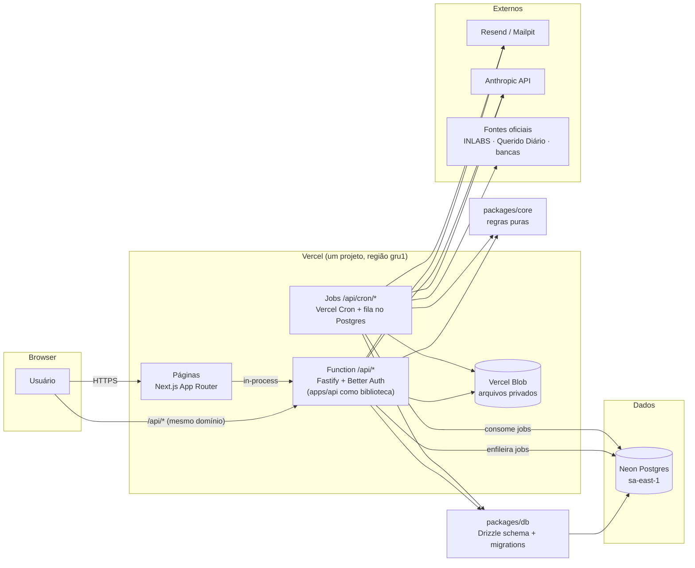
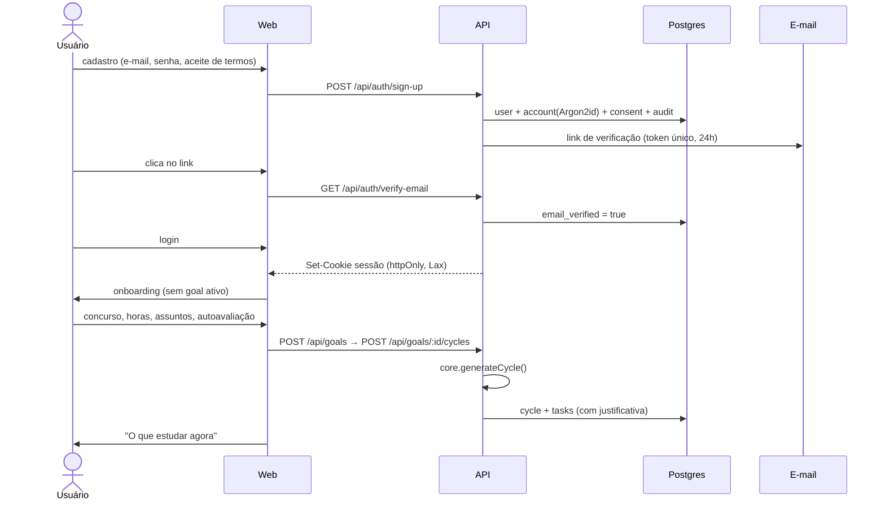

# AprovaAI — Plano de arquitetura (Etapa A)

> Status: **aprovado** em 2026-10-27. Etapa B (fundação) implementada; ver "Status atual" no CLAUDE.md.
> Data: 2026-10-26.

## 1. Visão geral

O AprovaAI responde, para cada candidato, **"o que eu devo estudar agora, e por quê?"**.
O núcleo é determinístico: regras puras em `packages/core` (prioridade, ciclo,
repetição espaçada, pontuação). A IA, quando entrar (Etapa F+), só **extrai,
classifica e explica**. Ela nunca decide a prioridade sozinha.



**Decisão-chave de hospedagem (revisada em 2026-10-27, ADR-009):** tudo roda num único
projeto Vercel. A API Fastify é uma biblioteca (`apps/api`) executada dentro da rota
`apps/web/src/app/api/[...path]/route.ts`, via `inject`, sem porta HTTP. O navegador só
conhece um domínio, então o cookie de sessão é **first-party**, o CORS fica praticamente
fechado e o CSRF fica mais simples. Os Server Components chamam a API no mesmo processo.
Jobs agendados (Etapas G/H) viram rotas `/api/cron/*` disparadas pelo Vercel Cron (ADR-010).
Guia: [deploy.md](deploy.md).

## 2. Estrutura de diretórios

```
aprovaai/
├─ apps/
│  ├─ web/                    # Next.js (App Router), Tailwind, shadcn/ui
│  │  ├─ src/app/(public)/    # landing, login, cadastro, verificação, recuperação, termos
│  │  ├─ src/app/(app)/       # área logada: dashboard, agora, plano, questões, ...
│  │  ├─ src/app/(admin)/     # painel admin/editor
│  │  ├─ src/components/      # ui/ (shadcn) + componentes de domínio
│  │  ├─ src/lib/             # api-client tipado, auth-client, query keys
│  │  └─ e2e/                 # Playwright
│  │  └─ src/app/api/[...path]/route.ts   # executa a API Fastify (Vercel Function)
│  ├─ api/                    # API Fastify como biblioteca (buildApp, getApi, handleFetchRequest)
│  │  ├─ src/modules/<domínio>/   # routes.ts, service.ts, repository.ts, schemas.ts
│  │  │   (auth, users, catalog, goals, planner, sessions, questions,
│  │  │    reviews, mock-exams, materials, admin, privacy, ai, radar, cron)
│  │  ├─ src/plugins/         # auth, rbac, rate-limit, security-headers, errors, csrf
│  │  ├─ src/lib/             # email provider, storage, logger, config (env Zod)
│  │  └─ test/                # integração (Vitest + Postgres de teste)
│  └─ worker/                 # (Etapa G) jobs como funções puras chamadas pelas rotas /api/cron/*
│     ├─ src/jobs/            # send-email, process-past-exam, radar-collect, ...
│     ├─ src/connectors/      # ProvaSourceConnector / RadarSourceConnector
│     └─ test/fixtures/       # PDFs/XML reais salvos (sem rede nos testes)
├─ packages/
│  ├─ core/                   # planner/, spaced-repetition/, scoring/, metrics/ (+ testes)
│  ├─ db/                     # schema/*.ts, migrations/, seed/, client.ts
│  ├─ shared/                 # schemas Zod compartilhados web↔api, enums, tipos de DTO
│  └─ config/                 # tsconfig base, eslint, prettier
├─ docs/                      # architecture.md, decisions.md, security.md, backlog.md,
│                             # sources.md, legal.md, deploy.md
├─ docker-compose.yml         # só infra local: postgres (+ banco de teste) e mailpit
├─ .github/workflows/ci.yml
├─ CLAUDE.md · README.md · .env.example
└─ pnpm-workspace.yaml · turbo.json
```

`packages/shared` não estava no pedido. Entrei com ele porque os schemas Zod de
entrada/saída precisam ser os mesmos no formulário (React Hook Form) e na API.
Sem ele, eles seriam duplicados.

## 3. Escolhas justificadas

| Tema          | Escolha                                                                                                                                                         | Por quê (1–2 frases)                                                                                                                                                                                                                                                                       |
| ------------- | --------------------------------------------------------------------------------------------------------------------------------------------------------------- | ------------------------------------------------------------------------------------------------------------------------------------------------------------------------------------------------------------------------------------------------------------------------------------------ |
| Monorepo      | **pnpm workspaces + Turborepo**                                                                                                                                 | pnpm já está instalado e é rápido no Windows. O Turbo faz cache de lint/typecheck/test/build por pacote, o que acelera o CI.                                                                                                                                                               |
| ORM           | **Drizzle**                                                                                                                                                     | É SQL-first e tipado sem engine binária. `CHECK`, índices parciais e RLS ficam declarados no schema/migrations em SQL legível, e o Better Auth tem adapter oficial para ele. O Prisma exigiria SQL cru para boa parte dessas restrições.                                                   |
| Auth          | **Better Auth** (montado no Fastify)                                                                                                                            | É TypeScript nativo e independente de framework. Já traz verificação de e-mail, reset de senha, sessões em banco, revogação de todas as sessões, rate limit, OAuth Google e plugin de papéis. O Auth.js é centrado no Next e desencoraja e-mail/senha (sem reset nem verificação prontos). |
| Hash de senha | **Argon2id** via `@node-rs/argon2`, plugado no `password.hash/verify` do Better Auth                                                                            | O padrão do Better Auth é scrypt. Troco por Argon2id para cumprir o requisito usando uma lib madura, sem cripto na mão.                                                                                                                                                                    |
| Sessão        | **Cookie de sessão opaco em banco** (`httpOnly`, `Secure` em prod, `SameSite=Lax`), expiração deslizante, novo token a cada login/troca de senha/troca de papel | Revogar é instantâneo (logout de todas as sessões, desativar usuário), o que é difícil com JWT. Como web e API ficam no mesmo domínio (mesmo projeto Vercel), não precisamos de access/refresh token.                                                                                      |
| CSRF          | `SameSite=Lax` + checagem de `Origin` em toda requisição mutável + só JSON                                                                                      | O Better Auth já valida `trustedOrigins`, e um hook do Fastify aplica a mesma regra às rotas de domínio.                                                                                                                                                                                   |
| API           | **Fastify + Zod** (`fastify-type-provider-zod`) + `@fastify/swagger`                                                                                            | Os schemas Zod viram validação, tipos e OpenAPI de uma vez. O Fastify já usa pino nativamente.                                                                                                                                                                                             |
| Fila          | **Tabela de jobs no Postgres + Vercel Cron**                                                                                                                    | Na Vercel não há processo de longa duração para o pg-boss. Rotas `/api/cron/*` (protegidas por `CRON_SECRET`) pegam lotes com `FOR UPDATE SKIP LOCKED`, com retry/backoff e idempotência por hash (ADR-010).                                                                               |
| E-mail        | Interface `EmailProvider` com `SmtpProvider` (Mailpit em dev) e `ResendProvider` (prod)                                                                         | O provedor é trocado por variável de ambiente, e os testes usam um provider em memória.                                                                                                                                                                                                    |
| Arquivos      | Interface `FileStorage`: disco local fora da pasta pública (dev) → **Vercel Blob** privado (prod)                                                               | Tipo verificado por _magic bytes_ (`file-type`), com limite de tamanho e nome gerado (UUID).                                                                                                                                                                                               |
| IA            | Interface `AiProvider` + `AnthropicProvider`                                                                                                                    | Sem `ANTHROPIC_API_KEY`, a feature fica desligada e a UI diz isso. Nada de resposta simulada.                                                                                                                                                                                              |
| Fuso          | Tudo em UTC no banco. "Dia" calculado no fuso do usuário (padrão `America/Sao_Paulo`)                                                                           | Constância, revisões "de hoje" e disponibilidade por dia dependem disso.                                                                                                                                                                                                                   |

## 4. Modelo de dados

Convenções: PK `uuid` (`gen_random_uuid()`), `created_at`/`updated_at timestamptz`,
`deleted_at` onde há soft delete. Enums como `pgEnum`. Todo dado privado tem
`user_id NOT NULL` com `ON DELETE CASCADE`.

### 4.1 Ajustes em relação à lista base (e por quê)

1. **Papel como coluna `users.role`** (`user|editor|admin`) em vez da tabela `user_roles`.
   Um papel por usuário basta, e é o formato do plugin admin do Better Auth.
2. **Taxonomia canônica separada do edital.** Questões, provas antigas e o Raio-X da
   banca precisam falar a mesma língua entre concursos diferentes ("Atos
   administrativos" é o mesmo assunto no TRT e no INSS). Por isso:
   - `subjects` / `topics` = **taxonomia global** (disciplina → assunto → subassunto
     via `parent_topic_id`), mantida por editores.
   - `notice_subjects` / `notice_topics` = **o que um edital específico cobra**
     (peso, nº de questões, relevância, texto literal do edital), apontando para a
     taxonomia.
   - Questões e estatísticas da banca referenciam a taxonomia. O planejador
     trabalha sobre `notice_topics` e cruza com os dados via `topic_id`.
3. **`boards` (bancas) e `organizations` (órgãos) viram tabelas**, porque são filtro
   em catálogo, questões, provas, Raio-X, alertas e seguir concurso.
4. `verification_tokens` → tabela `verifications` do Better Auth (verificação de
   e-mail e reset, uso único com expiração).

### 4.2 Tabelas

**Auth e contas**

- `users`: email (único, citext), email_verified, name, role, status (`active|disabled`), timezone, deleted_at
- `accounts`: provider (credential/google), password_hash (Argon2id), provider_account_id
- `sessions`: token (hash), expires_at, ip, user_agent
- `verifications`: identifier, value (hash), expires_at
- `rate_limits`: armazenamento de rate limit/lockout do Better Auth (por IP + rota)
- `user_profiles`: display_name, education_level, interest_areas[], study_preferences jsonb
- `consents`: user_id, document (`terms|privacy|analytics`), version, accepted_at, ip
- `audit_logs`: actor_user_id, action, target_type, target_id, metadata jsonb (sem PII sensível), ip, created_at
- `feature_flags`: key, enabled, description, updated_by

**Catálogo**

- `boards`: name, slug, default_question_type
- `organizations`: name, acronym, sphere (`federal|estadual|municipal`), uf, city
- `exams`: organization_id, board_id (nullable), title, sphere, uf, city, situation (`previsto|autorizado|banca_definida|edital_publicado|encerrado`), situation_confirmed bool, edital_date, registration_start/end, exam_date (todas nullable, "não confirmado" na UI), official_url, last_verified_at, **owner_user_id** (null = catálogo; preenchido = concurso privado), content_status, content_origin, source_reference_id
- `exam_positions`: exam_id, title (cargo), education_level, salary (nullable + `salary_confirmed`), vacancies
- `exam_notices`: exam_id, version, published_at, official_url, is_current, scoring_rule_id
- `scoring_rules`: name, type (`standard|wrong_cancels_right`), penalty_ratio, blank_allowed, params jsonb
- `subjects`: name, slug, owner_user_id (taxonomia privada quando o usuário cria algo que não existe)
- `topics`: subject_id, parent_topic_id, name, owner_user_id
- `notice_subjects`: notice_id, position_id (null = comum a todos os cargos), subject_id, weight, question_count, kind (`basica|especifica`)
- `notice_topics`: notice_subject_id, topic_id, relevance (1–5), raw_text
- `source_references`: url, title, retrieved_at, hash, notes

Todo conteúdo de catálogo tem `content_status` (`rascunho|em_revisao|validado`),
`content_origin` (`oficial|autoral|usuario|gerado_por_ia`), `source_reference_id`
e `is_sample` (para o comando que remove dados de exemplo).

**Plano**

- `user_exam_goals`: user_id, exam_id, position_id, notice_id, target_exam_date (override do usuário), weekly_availability jsonb (`{mon: 120, …}` em minutos), block_duration_min, priority_weights jsonb (null = padrão global), review_intervals int[] (padrão `{1,7,30}`), is_active
- `user_topic_states`: user_id, goal_id, notice_topic_id, is_active, self_assessment (0–100), status (`nao_iniciado|em_andamento|coberto`), last_studied_at, last_reviewed_at
- `study_cycles`: user_id, goal_id, number, phase (`base|inicial|intermediaria|reta_final`), generated_at, input_hash (prova de determinismo), status (`ativo|encerrado`), conflicts jsonb
- `study_tasks`: user_id, cycle_id, notice_topic_id, type (`teoria|questoes|revisao|lei_seca|simulado|analise_erros`), suggested_date, order_index, duration_min `CHECK > 0`, priority numeric, justification text, status (`pendente|em_andamento|concluida|pulada|reagendada|cancelada`), completed_at, superseded_by_cycle_id
- `study_sessions`: user_id, task_id (nullable), notice_topic_id (nullable), started_at, ended_at, net_minutes `CHECK > 0`, source (`manual|cronometro|pomodoro`)

**Questões**

- `questions`: owner_user_id (null = catálogo), type (`multipla_escolha|certo_errado`), statement (nullable no cadastro rápido), board_id, organization_id, year, subject_id, topic_id, difficulty, correct_answer, explanation, explanation_origin, source_url, usage_permission, content_status, is_sample, annulled
- `question_options`: question_id, label (A–E), text, order
- `question_attempts` (**append-only**): user_id, question_id, answer, is_correct, error_type (`falta_de_teoria|pegadinha_da_banca|falta_de_atencao|interpretacao|chute|esquecimento`), time_spent_sec, context (`avulsa|revisao|simulado|registro_externo`), mock_exam_attempt_id, idempotency_key (único por usuário), answered_at
- `question_notes`: user_id, question_id, body
- `question_lists` + `question_list_items`: listas personalizadas e favoritos (lista padrão "Favoritas")
- `question_reports`: user_id, question_id, reason, status (`aberto|aceito|rejeitado`), resolved_by

**Revisão**

- `review_items`: user_id, question_id, stage (índice em `review_intervals`), due_date, status (`ativa|dominada`), last_result, updated_at. Único por (user_id, question_id).

**Simulados**

- `mock_exams`: user_id, goal_id, title, config jsonb (disciplinas, distribuição, tempo), scoring_rule_id
- `mock_exam_questions`: mock_exam_id, question_id, order
- `mock_exam_attempts`: user_id, mock_exam_id, started_at, finished_at, score, result jsonb (por disciplina/assunto)

**Materiais e IA**

- `materials`: user_id, topic_id, kind (`link|anotacao|resumo|referencia`), title, url, body, is_favorite, completed_at
- `ai_interactions`: user_id, feature, model, input_tokens, output_tokens, cost_usd, status, error_code (sem conteúdo pessoal)

**Provas anteriores e banca (Etapa G)**

- `past_exams`: board_id, organization_id, position_title, year, area, exam_pdf_url, answer_key_url, file_hash (único), processing_status, source_reference_id
- `past_exam_questions`: past_exam_id, question_id, number, annulled, classification_confidence, needs_review
- `board_topic_stats`: board_id, topic_id, scope (geral/órgão/cargo/área), period_start/end, question_count, incidence, sample_exams, trend

**Radar (Etapa H)**

- `sources`: connector key, base_url, terms_checked_at, terms_notes, rate_limit_per_min, enabled
- `source_runs`: source_id, started_at, finished_at, status, docs_found, docs_new, error
- `source_documents`: source_id, url, hash (único), published_at, text, storage_key
- `exam_events`: exam_id (nullable até casar), source_document_id, type, extracted jsonb, confidence, excerpt, confirmation_status (`auto|pendente|confirmado|rejeitado`)
- `exam_follows`: user_id, exam_id
- `alert_rules`: user_id, keywords[], uf, area, board_id, education_level, frequency (`imediato|resumo_diario`)
- `notifications`: user_id, type, payload, read_at, emailed_at

`jobs`: tabela própria (tipo, payload, status, tentativas, `run_after`, `dedupe_key` única), consumida pelas rotas de cron (ADR-010).

### 4.3 Índices principais

- `question_attempts (user_id, answered_at DESC)`, `(user_id, question_id)`, `(user_id, topic_id via question)`
- `review_items (user_id, status, due_date)`
- `study_tasks (user_id, cycle_id, status, order_index)`
- `questions (topic_id, board_id, year) WHERE owner_user_id IS NULL`
- `exams (situation, uf, board_id)`. Busca textual com `pg_trgm` em `exams.title` e `organizations.name`.
- `source_documents (hash)` único, `past_exams (file_hash)` único.

### 4.4 Isolamento e exclusão de conta

- **Camada 1 (obrigatória):** repositórios de dado privado recebem `userId` como
  argumento obrigatório. Não existe método "buscar por id" sem dono. Rota com recurso
  de outro usuário responde **404** (não 403), para não revelar existência.
- **Camada 2 (RLS):** recomendo ativar na **Etapa I**, com `SET LOCAL app.user_id`
  por transação e um papel de banco sem `BYPASSRLS` para a API. Ativar já na
  fundação complica pool, migrations e testes antes de existir domínio para proteger
  (ADR registrado).
- **Testes de isolamento:** uma suíte parametrizada percorre todo recurso privado
  (GET/PATCH/DELETE de A com sessão de B → 404) e falha se um recurso novo não
  for registrado nela.
- **Exclusão de conta:** ao confirmar com senha, o usuário entra em `deleted_at` e
  as sessões são revogadas na hora. Um job remove em cascata os dados privados. O
  que precisa ficar por motivo legítimo (logs de auditoria, `question_reports`
  aceitos) é **anonimizado** (`user_id` → null, e-mail removido). Os prazos ficam em
  `docs/security.md` (retenção).

## 5. Motor de planejamento (packages/core)

Função pura `generateCycle(input) → { tasks, conflicts, phase, warnings }`, sem
acesso a banco nem relógio (a data "hoje" entra como parâmetro).

1. **Validação:** edital sem assuntos ativos, zero horas, prova no passado e todos
   os pesos zero viram `warnings`/erros tipados com mensagem em português.
2. **Fase:** dias até a prova → `base` (sem data) / >90 / 30–90 / <30, que define a
   fatia de revisão (20/35/50%) e o simulado semanal.
3. **Prioridade por assunto:** os cinco fatores normalizados 0–1 com os pesos do
   usuário (ou o padrão global). Até ter 10 tentativas, a dificuldade vem da
   autoavaliação. Incidência na banca = 0,5 enquanto não houver Raio-X.
4. **Orçamento:** minutos semanais → primeiro as revisões vencidas (fatia
   reservada), depois 1 bloco mínimo por disciplina ativa, e o restante
   proporcional à prioridade, em blocos da duração preferida.
5. **Tipo do bloco:** vem dos erros dominantes do assunto (teoria / questões da
   mesma banca / cronometradas / revisão curta). Sem erros, segue a sequência
   teoria → questões.
6. **Distribuição nos dias:** preenche cada dia até a disponibilidade dele, nunca
   além. O que sobrar vira `conflict` exibido na tela.
7. **Determinismo:** ordenação estável (prioridade desc, depois `topic_id`), sem
   `Math.random`, com `input_hash` gravado no ciclo.
8. **Recalcular:** concluídas, puladas e em andamento são **mantidas**. Só as
   pendentes do ciclo ativo viram `cancelada` (com `superseded_by_cycle_id`), então
   o histórico nunca é apagado.

"Ciclo, não cronograma": `suggested_date` serve para o calendário, mas a tela
**"O que estudar agora"** mostra a **próxima tarefa pendente por `order_index`**.
Perder um dia não acumula atraso, a fila só anda.

**Repetição espaçada:** `nextReviewState(item, result, intervals, today)`.
Acertou → avança um estágio. Errou → volta ao estágio 0. Passou do último
intervalo → `dominada`.

**Pontuação:** `scoreMockExam(answers, scoringRule)` cobre o padrão e o
"errada anula certa" (Cebraspe), com brancos.

Os testes cobrem todas as regras obrigatórias da seção 7.3 e as bordas: lista
vazia, zero horas, peso zero, assunto sem questões, prova sem data ou no passado,
revisão atrasada.

## 6. Fluxos principais



Os outros fluxos (detalhados na Etapa correspondente):

- **Responder questão:** tentativa nova (idempotente). Se errou, pede o tipo de erro,
  cria ou reinicia o `review_item` e atualiza `user_topic_states`. O próximo
  recálculo já usa esses dados.
- **Recuperar senha:** mesma resposta exista o e-mail ou não. Token único de
  30 min. Ao trocar, todas as sessões são revogadas e o evento vai para a auditoria.
- **Editor publica catálogo:** rascunho → em revisão → validado, com auditoria.
- **Pipeline de prova / radar:** jobs na tabela `jobs`, processados em lotes pelo Vercel Cron, idempotentes por hash (Etapas G/H).

## 7. Escopo exato do MVP (Etapas B–E)

**Dentro:**

- Fundação: monorepo, Compose (infra local), migrations, seed de exemplo marcado, CI, docs.
- Auth completa (cadastro, verificação, login/logout, logout de todas as sessões,
  recuperação, troca de senha), RBAC, lockout, rate limit, auditoria, isolamento testado.
- Catálogo com CRUD de editor + importação JSON/CSV de edital, busca e filtros.
  Concurso privado do usuário.
- Onboarding, motor do ciclo, "O que estudar agora" com cronômetro, calendário
  semanal com arrastar, sessões manuais/pomodoro.
- Questões (catálogo + pessoais + cadastro rápido), resolução com cronômetro,
  tentativas, classificação de erro, caderno de erros, revisões 1/7/30, anotações,
  listas/favoritos, reporte de erro.
- Dashboard com métricas reais.
- Simulados com regra de pontuação, painel admin (usuários, papéis, moderação,
  métricas agregadas, flags), LGPD (termos versionados, exportar JSON, excluir conta).
- Materiais por assunto.

**Fora do MVP:** login Google (código atrás de flag, desligado), IA (F), worker de
provas e Raio-X (G), radar (H), RLS e hardening final (I), notificações por e-mail
além das transacionais, analytics.

## 8. Riscos e mitigações

| Risco                                         | Mitigação                                                                                                                                                                     |
| --------------------------------------------- | ----------------------------------------------------------------------------------------------------------------------------------------------------------------------------- |
| **Escopo grande para um dev**                 | MVP fechado (seção 7), etapas pequenas, um commit por funcionalidade. Etapas F–H só depois do critério de pronto do MVP.                                                      |
| Vazamento entre usuários (IDOR)               | `userId` obrigatório nos repositórios, 404 para recurso alheio, suíte de isolamento que falha se faltar recurso, RLS na Etapa I.                                              |
| Limites serverless (duração, cron, sem disco) | Jobs em lotes curtos e retomáveis, arquivos no Vercel Blob, região gru1 + Neon sa-east-1 (ver deploy.md).                                                                     |
| Enumeração de e-mail / força bruta            | Respostas idênticas, rate limit por IP + e-mail, lockout temporário, tempo de resposta constante no reset.                                                                    |
| Direitos autorais das provas e scraping       | Só fontes oficiais com termos verificados (`docs/sources.md`), texto integral atrás de flag, crédito e link para a fonte (`docs/legal.md`). Agregadores comerciais proibidos. |
| LGPD                                          | Minimização, consentimento versionado, exportação/exclusão, logs sem PII (pino `redact`), retenção documentada. Texto jurídico marcado como placeholder.                      |
| Prompt injection via PDF / custo de IA        | Conteúdo de PDF tratado como dado, saída validada por Zod, confirmação humana, cota e rate limit, `ai_interactions`.                                                          |
| Qualidade da extração de PDF                  | Fila de revisão humana, nada vira `validado` sem conferência, testes com fixtures reais.                                                                                      |
| Prioridade "parecer científica"               | Pesos documentados como parâmetros iniciais. A justificativa mostra os números usados. Sem "probabilidade de aprovação".                                                      |
| Fuso e "dia"                                  | UTC no banco, cálculo de dia no fuso do usuário em `core`, testes com virada de dia.                                                                                          |

## 9. Verificação planejada (por etapa)

`pnpm lint` · `pnpm typecheck` · `pnpm test` (core + integração da API com
`postgres-test` do Compose) · `pnpm build` · Playwright no fluxo E2E crítico
(cadastro → onboarding → ciclo → questão → revisão). Tudo roda no CI (GitHub
Actions com serviço Postgres) e localmente no PowerShell.
