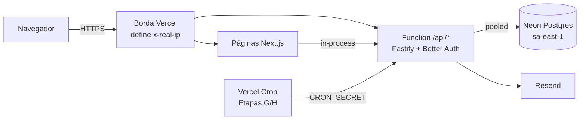

# Deploy na Vercel

Tudo roda num **único projeto Vercel**: as páginas Next.js e a API Fastify, que fica embutida na rota
`apps/web/src/app/api/[...path]/route.ts` e roda como Vercel Function Node.js. O banco é o **Neon**
(Postgres serverless), conectado pelo Marketplace da Vercel. O e-mail transacional sai pelo **Resend**.



## Estado atual (2026-10-27)

- Projeto Vercel `aprovaai` (Root Directory `apps/web`, Node 24, Git em `main`): **https://aprovaai-nine.vercel.app**.
  O domínio `aprovaai.vercel.app` pertence a outro projeto; não é este.
- Banco Neon `aprovaai-db` (gru1) conectado em Production, Preview e Development: os previews usam o mesmo banco
  da produção até ativar branch por preview.
- `BETTER_AUTH_SECRET` definido em Production e Preview.
- **Pendente:** Resend (`EMAIL_PROVIDER`, `RESEND_API_KEY`, `EMAIL_FROM`).

## 1. Banco (Neon pelo Marketplace)

1. No painel da Vercel: **Storage → Create Database → Neon**. Escolha a região **São Paulo (sa-east-1)**,
   a mesma das functions (`gru1`, definida em `apps/web/vercel.json`).
2. Conecte o banco ao projeto. A integração cria `DATABASE_URL` (com pooler) e `DATABASE_URL_UNPOOLED` (conexão direta).
3. (Opcional, recomendado) Ative **branch por preview** na integração. Cada deploy de preview ganha uma cópia do banco.
   Nesse caso, defina `MIGRATE_ON_PREVIEW=true` no ambiente **Preview**.

## 2. Projeto na Vercel

1. **Add New → Project** e importe o repositório do GitHub.
2. **Root Directory:** `apps/web`. A Vercel detecta o Next.js e o pnpm workspace e instala a partir da raiz.
3. O build usa `apps/web/vercel.json` → `pnpm vercel-build`, que:
   - aplica as migrations e os dados de referência (feature flags) com `DATABASE_URL_UNPOOLED`.
     Isso acontece só em produção, ou em preview com `MIGRATE_ON_PREVIEW=true`;
   - roda `next build`.
4. Node.js: 22.x ou superior (Settings → General).

## 3. Variáveis de ambiente

| Variável                                   | Ambientes                                | Valor                                                                                     |
| ------------------------------------------ | ---------------------------------------- | ----------------------------------------------------------------------------------------- |
| `DATABASE_URL`, `DATABASE_URL_UNPOOLED`    | todos                                    | criadas pela integração Neon                                                              |
| `BETTER_AUTH_SECRET`                       | Production, Preview (valores diferentes) | `node -e "console.log(require('crypto').randomBytes(32).toString('base64url'))"`          |
| `EMAIL_PROVIDER`                           | todos                                    | `resend`                                                                                  |
| `RESEND_API_KEY`                           | todos                                    | chave do Resend                                                                           |
| `EMAIL_FROM`                               | todos                                    | ex.: `AprovaAI <nao-responda@seudominio.com.br>` (domínio verificado no Resend)           |
| `APP_URL`                                  | Production (opcional)                    | domínio próprio, ex.: `https://aprovaai.com.br`. Sem ela, usa o `.vercel.app` de produção |
| `TRUSTED_ORIGINS`                          | Production (opcional)                    | outros domínios que servem o app                                                          |
| `MIGRATE_ON_PREVIEW`                       | Preview (opcional)                       | `true` só com branch de banco por preview                                                 |
| `GOOGLE_CLIENT_ID`, `GOOGLE_CLIENT_SECRET` | opcional                                 | login Google (também exige a flag `google_login`)                                         |

Não precisam ser definidas: `CLIENT_IP_HEADER` (na Vercel o padrão é `x-real-ip`, definido pela borda) e
`APP_URL` em preview (a URL do deploy é usada automaticamente, ver `apps/api/src/config.ts`).

## Login com Google

1. No [Google Cloud Console](https://console.cloud.google.com/): crie (ou escolha) um projeto.
2. **APIs e serviços → Tela de consentimento OAuth** (Google Auth Platform): tipo **Externo**, nome `AprovaAI`,
   e-mail de suporte, escopos padrão (`openid`, `email`, `profile`). Enquanto estiver em **Teste**, só os
   usuários de teste cadastrados ali conseguem entrar; publique o app para liberar a todos.
3. **Credenciais → Criar credenciais → ID do cliente OAuth → Aplicativo da Web**:
   - Origens JavaScript autorizadas: `https://aprovaai-nine.vercel.app` e `http://localhost:3000`
   - URIs de redirecionamento autorizados: `https://aprovaai-nine.vercel.app/api/auth/callback/google` e
     `http://localhost:3000/api/auth/callback/google`
4. Na Vercel, defina `GOOGLE_CLIENT_ID` e `GOOGLE_CLIENT_SECRET` (Production) e faça redeploy.
   Em dev, coloque os mesmos valores no `.env`.
5. Ligue a flag no banco: `pnpm feature:set google_login on` (com `DATABASE_URL` do ambiente desejado).

Previews têm URL variável e o Google não aceita curinga no redirect: o login Google funciona em produção e em dev.

## IA (opcional)

1. Crie uma chave em console.anthropic.com e defina `ANTHROPIC_API_KEY` (Production). Opcional: `ANTHROPIC_MODEL`
   (padrão `claude-opus-5-5`) e `AI_DAILY_QUOTA` (padrão 30 usos por usuário a cada 24 h).
2. Ligue a flag `ai` em Admin → Feature flags (ou `pnpm feature:set ai on`).
3. Acompanhe o custo pela tabela `ai_interactions` (tokens e custo estimado por chamada).

## 4. Depois do primeiro deploy

1. Cadastre-se no site e confirme o e-mail.
2. Promova sua conta a admin rodando o CLI localmente contra o banco de produção:
   ```powershell
   $env:DATABASE_URL="<DATABASE_URL_UNPOOLED de produção>"; pnpm user:set-role voce@exemplo.com admin; Remove-Item Env:DATABASE_URL
   ```
3. Confira `https://<seu-app>/api/health` e `https://<seu-app>/api/ready`.

## Limites da Vercel que afetam o produto

- **Duração das functions:** com Fluid compute, até 300 s no Hobby e 800 s no Pro. O processamento de PDF e a coleta do
  radar (Etapas G/H) precisam caber nisso, em lotes. Ver ADR-010.
- **Cron:** no Hobby, cada cron roda no máximo 1x por dia. Para o radar 2x/dia, use o plano Pro ou dois crons diários.
- **Sem disco persistente:** uploads vão para o **Vercel Blob** (Etapa F/G), nunca para o sistema de arquivos.
- **Rate limit geral em memória** (`@fastify/rate-limit`) vale por instância. O rate limit de auth (Better Auth)
  fica no Postgres e vale globalmente. Ver docs/security.md.
- **Cold start:** a primeira requisição de uma instância inicializa o Fastify e o Better Auth (~centenas de ms).

## Desenvolvimento local

Nada muda: `docker compose up -d` (Postgres + Mailpit) e `pnpm dev`. A API responde em `http://localhost:3000/api/*`
e o Swagger em `http://localhost:3000/api/docs`.
